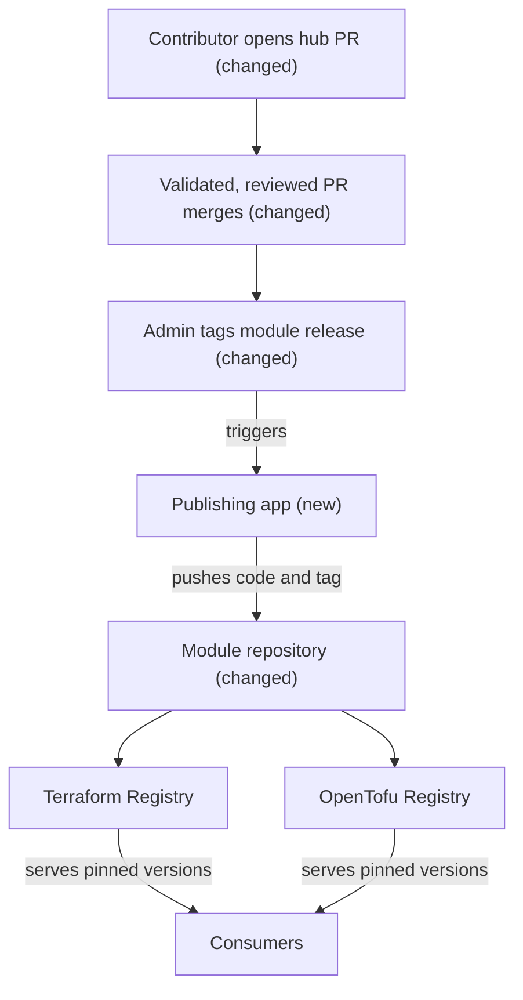

# Terraform Module Hub

We propose developing all 19 public Terraform modules in one hub repository and publishing each module's releases to its
own repository for the Terraform and OpenTofu registries. Today, maintainers keep 17 repositories with about 270
boilerplate copies and unchecked hand-typed release tags.

Here's how the hub publishes: after a reviewed change merges, an admin tags the module's release, and a publishing app
pushes the module's code and tag to the module repository, where we expect the registries to pick it up. Consumers of
the 17 published modules change nothing. The work runs in four phases, piloting before migrating the rest.

We chose the hub because CI, dependencies, and tooling change once, not 17 times, and every module gets validated before
release. The main risk is a registry missing a version; a check fails within 90 minutes, and only Terraform's registry
lets us fix it by hand.

[Read the full discovery](discovery.md)
